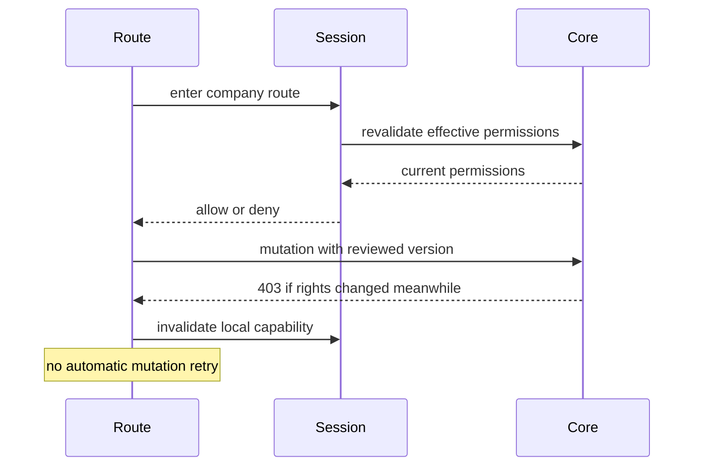

# UI → Core: проверенный контракт

Актуальный Sprint 6B API `/api/v1`: полный snapshot `projects/xarionix-console/contracts/core-openapi.json`, 95 paths. Core checkout отдельно закрепляется полным SHA через `CONSOLE_CORE_REF` после ручной публикации Core; JSON сравнивает API content, не Git HEAD. [Порядок обновления CI pin](unified-web-migration.md). Экспорт не запускает lifespan, миграции и не читает deployment `.env`:

```bash
../xarionix-core/.venv/bin/python scripts/console_contract.py --core ../xarionix-core --check
```

Таблица ниже описывает **human Console**, не deployment-agent/machine endpoints. UUID компании передаётся в path; ERP `X-Company-Id` и numeric company ID не используются.

| UI | Method / path (после `/api/v1`) | Request / response | Authority |
|---|---|---|---|
| Профиль | GET, PATCH `/me` | Profile / `{display_name}` | valid human access JWT; PATCH human classification |
| Dashboard | GET `/system/info`, `/me/companies` | version; Page Company | authenticated / human |
| Мои компании | GET, POST `/companies` | CompanyCreate → Company | human; creation policy/quota in Core |
| Компания | GET, PATCH `/companies/{company_id}` | CompanyPatch → Company | `core.company.read/manage` |
| Заявки | POST `/company-requests`, GET `/company-requests/me`, POST `/{id}/cancel` | CompanyCreate / RequestView | human / requester |
| Участники | GET, PATCH, DELETE `/companies/{company_id}/members[/{member_id}]` | Page Member / MemberPatch | `core.members.read/manage`; owner invariants |
| Сотрудники | GET, POST `/companies/{company_id}/employees`, GET/PATCH `/{id}` | EmployeeCreate/Patch/View | `core.employees.read/manage` |
| Приглашения | GET, POST `/companies/{company_id}/invitations`, DELETE `/{id}` | InvitationCreate; **issued secret once** | `core.invitations.manage` |
| Роли | GET, POST `/companies/{company_id}/roles`, GET/PATCH/DELETE `/{role_id}` | RoleCreate/Patch/View | `core.roles.read/create/manage`; expected_version for PATCH |
| Права роли | GET, PUT `roles/{role_id}/permissions` | `{permissions, expected_version}` | role read/manage + server delegation boundaries |
| Назначения | GET/POST `members/{id}/roles`, DELETE `/{role_id}` | `{role_id}` / Page Role | roles read/assign/revoke **and** `core.members.roles.assign` |
| Делегирование | GET, PUT `members/{id}/delegation` | `{permissions}` | `core.permissions.delegate` |
| Контекст | GET `/companies/{id}/me/permissions` | company/membership UUID, owner, keys | actual membership and Core effective permissions |
| Каталог | GET `/permissions`, `/role-templates` | Page Permission / Template | human; active available namespaces |
| Platform users | GET `/platform/users`, PATCH `/{id}` | UserStatusPatch/View | active Platform Admin + recent MFA |
| Классификация | PATCH `/platform/identities/{id}` | `{principal_type}` | Platform Admin + MFA; explicit identity UUID |
| Admins | GET, POST `/platform/admins`, DELETE `/{user_id}` | AdminAssignment/View | Platform Admin + MFA; last admin protected |
| Platform companies/requests | GET `/platform/companies`, GET `/platform/company-requests`, POST `/{id}/approve|reject` | Page / Review | Platform Admin + MFA |
| Settings/audit | GET/PATCH `/platform/settings`, GET `/platform/audit` | SettingsPatch/View / Page AuditView | Platform Admin + MFA |
| Издатели | GET/POST `/platform/package-publishers`, GET `/{id}`, POST `/{id}/revoke` | PublisherCreate/View | Platform Admin + MFA |
| Ключи | GET/POST `package-publishers/{id}/keys`, POST `/{key_id}/revoke` | public Ed25519 KeyCreate/View | Platform Admin + MFA |
| Namespace grants | GET/PUT `package-publishers/{id}/namespaces` | array grants / `{namespaces}` | Platform Admin + MFA; revocation terminal |
| Пакеты | GET/POST `/platform/packages`, GET `/{id}` | **raw binary body**, Package view | Platform Admin + MFA before and after upload |
| Manifest / verify / diff | GET `packages/{id}/manifest`, POST `/verify`, GET `/diff?previous_id=UUID` | strict Manifest / verification **report** / structured diff | Platform Admin + MFA |
| Установки | GET `/platform/module-installations`, GET `/{id}`, GET `/{id}/history` | Installation / Page history | Platform Admin + MFA |
| Install plans | POST `/platform/module-install-plans`, GET `/{id}`, POST `/{id}/approve|cancel|refresh` | PlanCreate; exact `{digest}`; InstallPlan | Platform Admin + MFA; server generation, expiry, trust |
| Operations | GET `/platform/module-install-operations` | Page operation | Platform Admin + MFA |
| Autonomous binding | POST `module-installations/{id}/bind-instance` | instance_id, SHA, expected_generation/revision | Platform Admin + MFA; existing service/instance only |
| Hosts | GET/POST `/platform/deployment-hosts`, POST `/{id}/enable|disable|revoke` | HostCreate / `{expected_revision}` | Platform Admin + MFA |
| Deployment plans | POST `/platform/deployment-plans`, GET `/{id}`, POST `/approve|cancel` | PlanCreate / exact `{digest}` | Platform Admin + MFA; host revision and both generations |
| Runtime / jobs | GET `/platform/runtime-deployments`, GET `/{installation_id}/jobs` | bounded Page without `total` | Platform Admin + MFA |
| Retirement | POST `/platform/module-installations/{id}/retire` | `{state,expected_installation_generation}` | Platform Admin + MFA; terminal `retired` |

Везде list pagination: `limit` 1–100, `offset` 0–100000. Console по умолчанию использует 20. Фильтры/сортировки, которых нет в API, не отправляются. Нет получения всех компаний, всех runtime или всего каталога ради одного селекта.

Фактические installation status: `installed_disabled`, `installed_enabled`, `removed`. Runtime mode: `oci_v1`, `external_agent`, `metadata_only`, `not_supported_in_4c`. Нельзя сравнивать их с придуманными `enabled` / `installed`.

FastAPI errors нормализуются из `detail.code`, string detail, validation array и HTTP/network failure. Произвольный серверный текст, `input`, `ctx`, stack trace и payload не отражаются в UI. Безопасный `X-Request-ID` показывается отдельно. Поддерживаются 400/401/403/404/408/409/413/415/422/429/503. При 409 нужен reload и повторная проверка; blind mutation retry нет.



## Подтверждённые API gaps

1. Нет GET отдельного runtime по installation UUID. Карточка из списка получает номер страницы; прямой URL предлагает bounded page locator. Минимальное будущее изменение: authenticated `GET /platform/runtime-deployments/{installation_id}` с тем же require_platform и 404, без изменения list contract.
2. Host view не возвращает issuer/subject/client_id; они вводятся как metadata при регистрации, но не выдумываются в последующем просмотре. Возможен отдельный admin-only detail endpoint, не меняющий существующий view.
3. MemberView содержит user UUID, без display_name. UI показывает реальные идентификаторы; нужен bounded server projection для дружелюбных имён, без N+1 и identity enumeration.
4. Нет OrgUnit API: `Employee.department` остаётся строкой, отдельная фиктивная иерархия не создаётся.
5. Нет декларативного module navigation API/Manifest field. Есть только безопасный validator для будущего compiled route registry; package frontend payload не запускается.
6. Platform Admin не получает автоматически company membership. Компания из глобального списка может быть недоступна через membership API; Console не расширяет права для обхода этого ограничения.

Core в данном Sprint не изменяется ради сокрытия этих ограничений.
