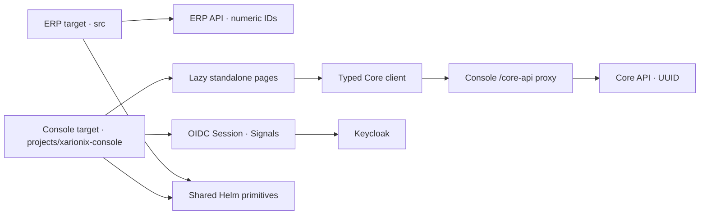
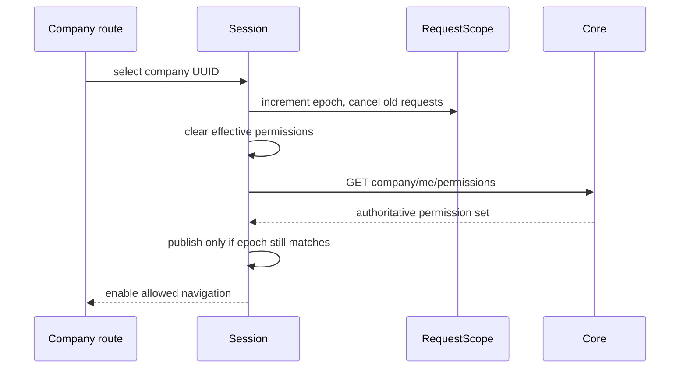
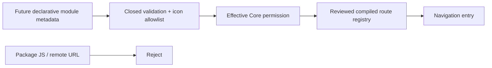

# Xarionix Platform Console — архитектура

Sprint 5 добавляет target `xarionix-console` в существующий Angular workspace. Исходная ERP — target `xarionix-web`, её `src/`, `/api/**`, числовые company ID, password authentication, карта и бизнес-модели не переносятся в Console.

Core baseline: `c6ab57707a0b2b486715017316e67d52b80b6d4e`. Соседний Core используется как read-only источник API, CLI и тестовых fixtures. ERP backend не изменяется.

Структура Console:

- `core`: публичная конфигурация, OIDC, HTTP boundary, Core DTO, session/company context, guards, clock, polling.
- `shared`: Spartan controls, paginated table, action/confirmation dialogs, permission/role pickers, safe structured reports, raw `.xpkg` upload.
- `pages`: профиль, dashboard, компании и участники, RBAC, platform administration, publishers, packages, installation/deployment plans, runtime и jobs.
- `contracts/core-openapi.json`: экспорт реального OpenAPI, дополненный строгой схемой Manifest из Core.
- `e2e`: настоящий browser Authorization Code + OTP, real Core operations и отдельный trusted test operator.

Используются Angular Signals, computed, RxJS и локальные stores страниц. NgRx и дополнительная UI-библиотека не добавляются. Одинаковые формы CRUD используют один Spartan Dialog; опасные подтверждения — Alert Dialog. Специальные страницы планов и пакетов имеют собственные модели и представления.

`RequestScope` увеличивает epoch при смене компании, завершении/истечении сессии. Все Core HTTP subscriptions прекращаются; PageData/LiveData очищают результаты. Асинхронные firstValueFrom-переходы дополнительно проверяют epoch. При смене UUID карточки Router создаёт новый store, вместо повторного использования старого detail-компонента.

Будущее объединение с ERP требует отдельной миграции identity/company/RBAC contracts. Shared Helm не означает shared auth. Нельзя подключить ERP interceptor к Console или заменить ERP proxy на Core.

Закрытая схема `.xpkg` Manifest сейчас не содержит navigation metadata. `core/navigation.ts` готовит строгую границу для будущего декларативного контракта: allowlisted icons, известная permission и только заранее скомпилированный маршрут. Произвольные package URLs, JS, HTML и route strings не исполняются. Несуществующая ERP microfrontend не имитируется.

