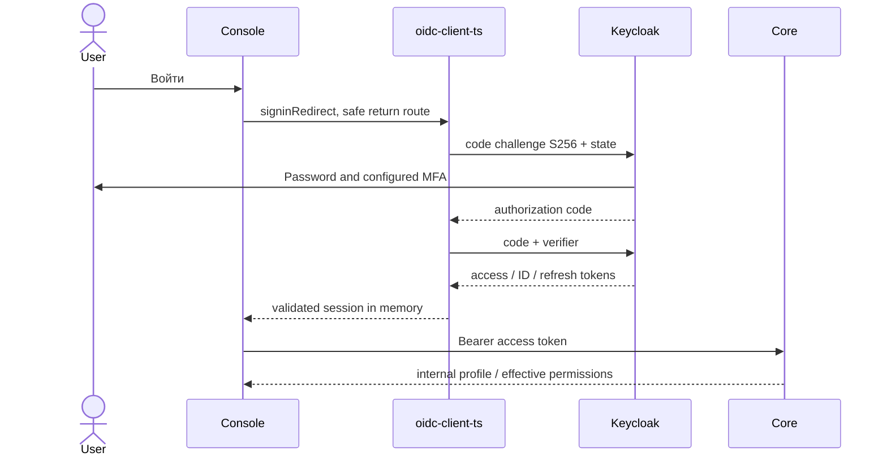
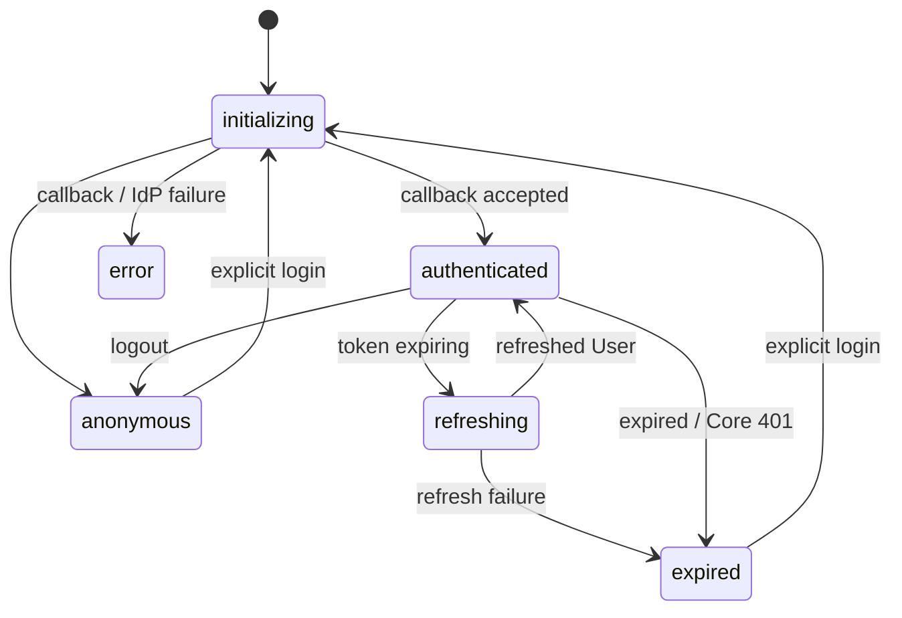
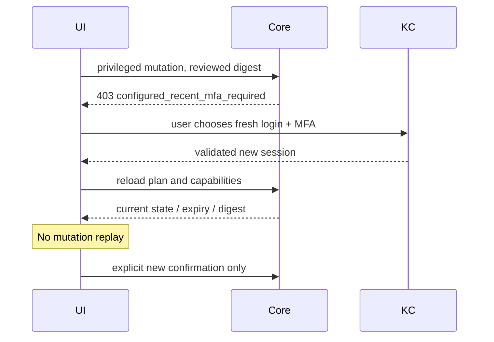

# Вход и сессия Console

Используется `oidc-client-ts` 3.5.0, public client, Authorization Code + PKCE S256. Protocol validation, state, code verifier и token endpoint принадлежат библиотеке. Core независимо проверяет подпись JWT, issuer, audience, сроки и principal purpose.

Не используются password grant в Angular, implicit flow, client secret, собственный OAuth-сервер или чтение JWT roles для авторизации.

User storage — `InMemoryWebStorage`. Access, ID и refresh tokens не записываются в localStorage, sessionStorage, IndexedDB или cookies Console. В sessionStorage библиотека хранит только краткоживущую транзакцию входа: state, nonce при его использовании библиотекой и PKCE verifier. После callback URL очищается через replaceState.

После полной перезагрузки вкладки память потеряна: пользователь проходит новый контролируемый вход через существующую Keycloak SSO-сессию. Console не хранит JWT ради «вечного входа» и не запускает бесконечные автоматические redirects.

Refresh выполняется библиотекой через refresh token в памяти. При истечении/ошибке refresh токены и stores очищаются, старые HTTP отменяются, открывается login с безопасным внутренним return route. При logout User удаляется **до** вызова end-session, поэтому ID token не передаётся как `id_token_hint` в URL. Keycloak может показать своё подтверждение logout; Console поддерживает этот штатный сценарий.

Platform Admin определяется read-only `GET /platform/settings`: 200 — подтверждённый доступ; `platform_admin_required` — отказ; `configured_recent_mfa_required` — администратор требует fresh MFA. Это основано на порядке проверок `require_platform` в данном Core baseline: active internal admin проверяется до MFA. Прочие ошибки не дают admin capability.

MFA challenge запускает **новый** `signinRedirect` с `prompt=login`, `max_age=0` и согласованным `acr_values`. Сохраняется только безопасный URL плана. После callback план и permissions перечитываются; approve, retire, revoke и другие mutations автоматически не повторяются.

Настройка public client:

- Client ID `xarionix-console`; public, standard flow on; direct access grants, implicit, service accounts off.
- Exact redirect URI `https://console.example.test/auth/callback`, exact post-logout URI `/auth/logged-out`, точный web origin.
- PKCE method S256, access token audience `xarionix-core` (audience mapper).
- Для Keycloak 26.8 нужны scopes/mappers `basic`, `profile`, `acr`; `auth_time`, `sub` и `acr` должны действительно присутствовать в access token. Нельзя заменять MFA hardcoded ACR mapper.
- `mfaAcr` в публичной конфигурации должен соответствовать реальному browser authentication flow и Core `XARIONIX_ADMIN_ACR_VALUES`. Примерный `urn:xarionix:mfa` не настраивает MFA сам по себе.

Fixture E2E использует реальный username/password + OTP flow с Conditional LoA 2 и ACR mapping. Все тестовые секреты случайные, приватные и не являются production-конфигурацией.

Ссылки: [oidc-client-ts](https://authts.github.io/oidc-client-ts/), [Keycloak authentication flows](https://www.keycloak.org/docs/26.8.0/server_admin/).
