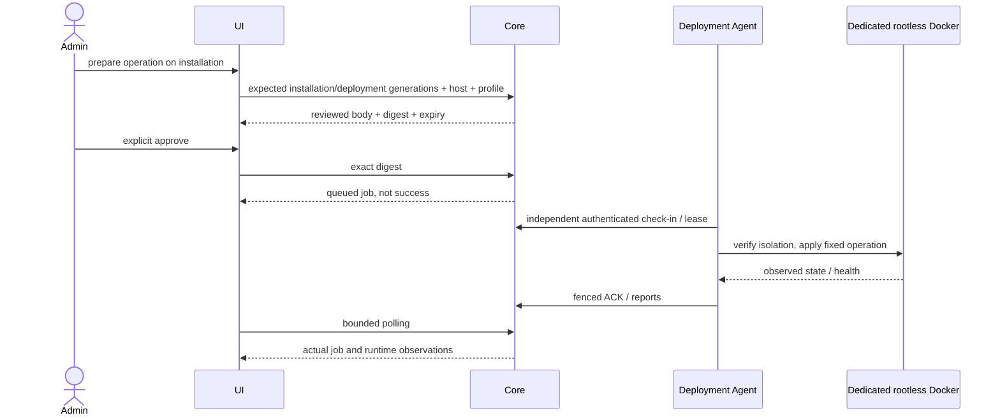
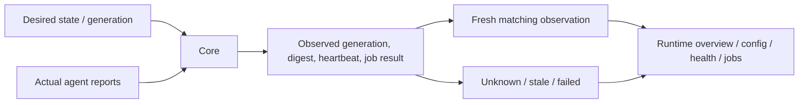

# Deployment, runtime и публикация Console

## Runtime

Host registration принимает только metadata: host UUID, name, issuer/subject/client ID существующей deployment identity, engine ID, platform. Никаких client secrets, SSH passwords или Docker sockets в форме. Enable/disable/revoke передают показанный `expected_revision`; conflict требует перечитать host.



Операции: provision, start, stop, restart, upgrade, rollback, deprovision, inspect, reconcile; quarantine/retire — через серверную security policy. Plan хранит host revision, profile, engine, package SHA, installation generation и deployment generation. В UI никогда не подставляется «новая версия» вместо conflict.

Provison создаёт остановленный контейнер; start запускает его и проверяет здоровье. Ни queued, ни leased не отображаются как успех. Устаревшие generation/digest/timestamps не подтверждают health. Polling serial, до 10 минут, прекращается на ошибке/выходе/смене контекста; manual retry запускает новый bounded read loop.



Retired — терминальное состояние; Console не предлагает восстановить отозванное доверие или стереть business DB. Остановка на offline host может задерживаться. Действия физически выполняет Agent, а не HTTP response об одобрении.

## Static frontend deployment

```bash
npm ci
npm run console:build
npm run console:bundle-check
```

Артефакт: `dist/xarionix-console/browser`. Публикуется отдельно от `dist/xarionix-web/browser`. Нет автоматического production deployment.

Production build получает `projects/xarionix-console/production/console-config.json`, где development=false и HTTPS issuer. Перед публикацией оператор заменяет example host на реальный. Dev build использует отдельный `public/console-config.json` с явным loopback HTTP.

`deploy/console/nginx.conf.example` — отдельный HTTPS vhost. Настроить реальные certificates, Console root, Core upstream и точный Keycloak origin в CSP. Core proxy — `/core-api/`; старый ERP `/api/**` не изменяется. Upstream HTTPS проверяется, credentials не пишутся в access logs. Защитные заголовки и Cache-Control заданы на одном server level: добавление одиночного `add_header` внутри location отменило бы их наследование. Применять только после `nginx -t`, затем штатный reload.

Публичный config содержит только: development, coreApi, coreHealth, issuer, clientId, mfaAcr, maxPackageBytes. Same-origin Core proxy обязателен. Секреты, CA private keys и service account credentials не являются частью bundle/config.

Console build отключает critical CSS inlining: сгенерированный `onload` на stylesheet несовместим с CSP `script-src 'self'`. `unsafe-eval`/inline JS не разрешаются. `style-src 'unsafe-inline'` требуется штатным Angular/CDK positioning и не разрешает выполнение script.

Пример production config — шаблон, не автоматическое получение домена/сертификата. Реальный production TLS/Keycloak требуют настроек администратора и не выдаются за локально проверенные deployment.
