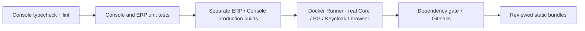

# Разработка и CI Console

Нужны Node 22.12+ (в CI закреплён Node 22), npm, sibling `xarionix-core` с установленным dev environment, Docker Compose v2. Для native positive runtime — отдельно выбранный пустой rootless Linux daemon с cgroup v2 delegation; это не frontend Runner.

```bash
npm ci
npm run console:start
```

Console: `http://localhost:4300`. ERP продолжает запускаться командой `npm start` на своём target. В dev config задать публичный issuer, clientId, mfaAcr. Core target proxy задаётся `XARIONIX_CONSOLE_CORE_TARGET`, по умолчанию `http://127.0.0.1:8000`. Настроить public Keycloak client по [authentication](platform-console-authentication.md). Нельзя использовать secret-bearing `.env` для Angular environment replacement.

```bash
npm run console:typecheck
npm run console:lint
npm run console:test
npm run console:build
npm run console:bundle-check
npm run console:security
npm test -- --watch=false
npm run build
```

Консоль и ERP test/build targets явные, поэтому добавление второго app не меняет смысл существующих npm commands. Core/ERP backend trees не изменяются.

Brain закреплён на исходной совместимой версии `1.3.4`. Автоматический переход на `1.9.0` через старый диапазон затрагивал контракты Dialog и ломал существующие ERP tests. Console использует фактически установленные primitives без правок общих Helm-компонентов.

## Настоящая браузерная интеграция

```bash
npx playwright install chromium
../xarionix-core/.venv/bin/python scripts/console_integration.py --core ../xarionix-core
```

Harness поднимает PostgreSQL Core и Keycloak, миграции, реальный Core image, public browser client с Code/PKCE и реальным OTP flow. Создание первоначальной human/admin identity выполняется явно доверенным тестовым оператором, не первым JWT. Создаются случайные отдельные Compose project/volumes. Существующие dev/prod базы не затрагиваются.

Создаётся подписанный пакет настоящего Hello OCI image. Браузер регистрирует public publisher/key/namespaces, загружает bytes, готовит/одобряет план. Отдельный Python operator по private file IPC запускает штатный restricted-role installer CLI. UI ожидает подтверждённый `applied`.

Default job проверяет реальные deployment plan/approval/queued job. Он **не** подделывает healthy report, если native engine не предоставлен. Для полного положительного пути:

```bash
../xarionix-core/.venv/bin/python scripts/console_integration.py \
  --core ../xarionix-core \
  --runtime-socket /absolute/path/to/dedicated-rootless.sock
```

Preflight отвергает Core-stack daemon, непустой/shared daemon и отсутствие реальных RAM/swap/PID/CPU limits. Можно предоставить защищённый локальный Unix forward к ранее разрешённому отдельному test daemon; Angular и Playwright остаются на машине разработчика. Harness запускает настоящий Deployment Agent с отдельной identity и проверяет provision → stopped → start → healthy → enable metadata → stop. Cleanup удаляет только созданные project/host-labelled ресурсы, не выполняет system prune.

`--keep` оставляет **только тестовое** окружение до Ctrl-C для локальной диагностики; private state path выводится без секретов. Private diagnostics не загружать в GitLab. `--smoke` запускает только login/profile/theme/logout.

## GitLab

Существующие `unit-tests` / `production-build` сохранены. Добавлены Console validate/typecheck/format+boundary checks, unit JUnit, production bundle gate, integration, npm dependency audit и Gitleaks.

`console:integration` использует существующий Docker executor tag `debian` и закреплённый rootless DinD image, аналогичный Core. Нужны TLS volume `/certs/client`, narrowly allowed privileged **service**, BuildKit, достаточные RAM/disk/time. Отсутствие Runner/daemon — видимый pending/failure; молчаливых skip/allow_failure нет.

В Core GitLab project разрешить job token **Web project** в inbound allowlist для read repository. Token не хранится в Git и не передаётся controller. `CONSOLE_CORE_REF` по умолчанию — audited commit `c6ab577...`; смена требует contract review и regeneration. URL строится из стандартных `CI_SERVER_URL` / `CI_PROJECT_NAMESPACE`; нет привязки к локальному Netbird hostname.

Внутренний controller монтирует workspace по daemon-side absolute path, поэтому Compose bind mounts работают и при DinD. Путь Dockerfile и build context Web также абсолютные: библиотека Core выполняет команды из своего каталога. Для проверки OpenAPI baseline переносится минимальная Git identity Core (HEAD/objects/refs), но не clone config с job credential, hooks и reflogs. Отчёты возвращаются только по allowlist (`console-e2e.xml`). Production secrets не нужны. Автоматического production deployment/publish нет.

Нативный positive runtime отдельно проверяется указанной выше командой. UI job не назначается `runtime-rootless`. Реальный GitLab pipeline считается успешным только после запуска на GitLab; локальные проверки не заменяют этот результат.


