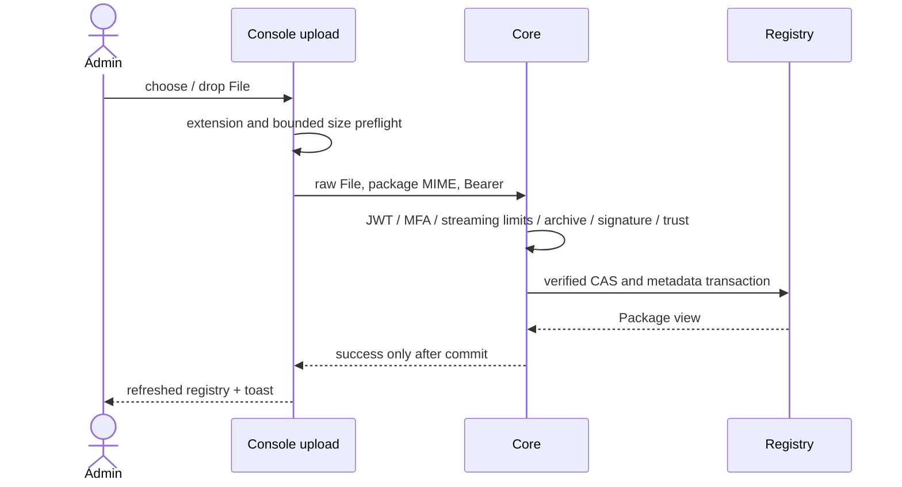
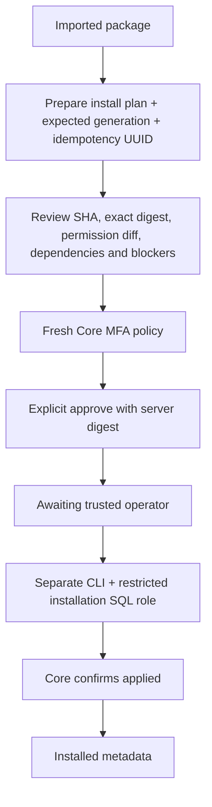
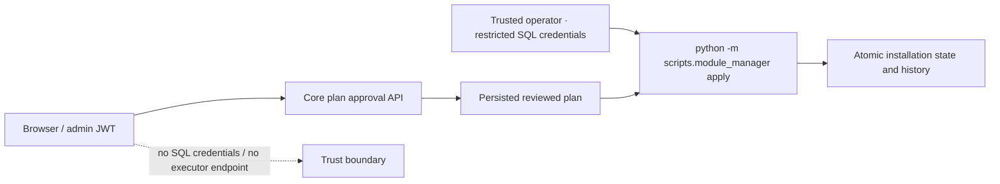

# Module Manager и доверенные операции

Импорт `.xpkg` — не установка, одобрение — не применение, metadata enabled — не отдельное доказательство healthy runtime.



Загрузка передаёт File в HttpClient непосредственно, без multipart и чтения всего архива JavaScript. Есть progress, server verification phase, cancel, размер и inline error. Cancel прекращает клиентскую подписку; не обещает откат уже завершённого сервером импорта. Повторная загрузка тех же bytes дедуплицируется Core.

Издатели: create/read/revoke; public Ed25519 key registration, fingerprint, terminal revoke; namespace grants. Private signing keys Console не принимает. Доверие и совместимость показываются из Core, не рассчитываются браузером как authority.



Plans: install/enable/disable/update/uninstall/rollback через реальные PlanCreate и version/generation constraints. Refresh создаёт новый plan ID/digest, одобрение не переносится. Expiry, revoked trust, changed dependency/permission generations и conflicts нельзя исправлять повтором старого approve.



Оператор использует штатный Core CLI:

```bash
python -m scripts.module_manager inspect --plan-id <plan-uuid>
python -m scripts.module_manager apply --plan-id <plan-uuid> --digest <reviewed-server-digest>
```

Его DB credentials настраиваются отдельно по документации Core. Эти commands приведены для доверенного оператора; они не отправляются в shell из Angular. В UI выводится plan UUID, состояние ожидания и инструкция, затем bounded polling проверяет реальный результат.

Для OCI порядок Core: `installed_disabled` → deployment provision/start → healthy → отдельный enable-plan → `installed_enabled`. Кнопка provision не блокируется искусственно из-за выключенных метаданных. Enable-plan до healthy имеет реальный blocker `runtime_not_healthy`, который Console показывает и не обходит.

Автономный модуль связывается только с уже зарегистрированным instance с проверкой SHA/generation/revision. Доступ machine identity не создаётся браузером.
