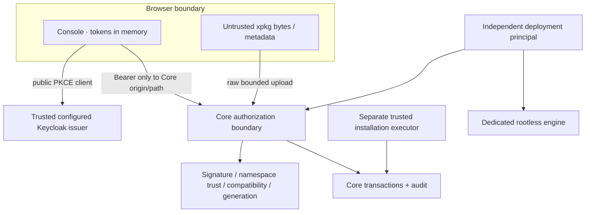

# Модель безопасности Console

Принципы:

- JWT roles не дают Platform Admin или company permissions. Authority — Core DB/RBAC/MFA.
- Memory-only User store; только theme preference persistent. OIDC transaction state не считается пользовательской сессией и не содержит token response.
- Auth header ставится только на помеченные Core requests с совпадающим origin и разрешённым API path. Health и сторонние запросы не получают Bearer.
- No wildcard credentialed CORS. Console использует same-origin proxy; token endpoint public client ограничивается точным Keycloak web origin.
- No eval, remote package import, innerHTML, bypassSecurityTrustHtml, unsafe script CSP или произвольный route из package.
- Server errors нормализуются; input/ctx/stack/payload не печатаются. Request ID ограничен безопасным алфавитом.
- Mutations не retry автоматически. Одобрение связано с показанным digest и версиями; fresh MFA не повторяет старую операцию.
- Logout/company switch отменяют старые запросы и очищают stores. UUID отделён от numeric ERP contracts.
- При блокировке текущего user Core сессия закрывается. 403 отзывает локальную permission capability; следующая route validation перечитывает её.
- Private keys, deployment secret, credentials broker, module DB passwords и Docker socket отсутствуют в frontend.

Проверки: `console:lint` (format + TypeScript AST boundary rules), `console:bundle-check`, `console:security`, Vitest и real Keycloak/Core browser integration. GitLab Gitleaks сканирует history с redact. Ни исходники, ни audit data не отправляются внешним AI/security services.

## Известное временное исключение зависимостей

Production dependency audit: обязательный `npm audit --omit=dev --audit-level=high`, без исключений.

В полном dev tree Spartan CLI 1.9.0 требует Zod 3.25.x. Advisory [GHSA-mrhx-c7xc-m3w5](https://github.com/advisories/GHSA-mrhx-c7xc-m3w5) исправлен в Zod 4.6.6, несовместимом с API генератора. Это локальный build-time generator, который не обрабатывает package/API input и не входит в runtime bundle. Замена на Zod 4 через override без совместимости была бы некорректной.

`scripts/console-security.mjs` допускает **только** этот advisory в `node_modules/@spartan-ng/cli/node_modules/zod` и обусловленную им запись CLI, только dev-only nodes, до **18 ноября 2026**. Новые high/critical, production exposure, иной nested path или истечение срока останавливают gate. Moderate tooling advisories остаются видимыми в измеренном baseline; breaking major upgrades всего workspace не выполняются ради зелёного audit.

Пересмотреть исключение после upstream исправления CLI. Это не `allow_failure`, не глобальное подавление Zod и не утверждение, что весь dependency tree свободен от уязвимостей.

## Test infrastructure

CI Docker job использует только разрешённый pinned rootless DinD service over TLS. Controller получает socket **этого job daemon**, а не VM/system Docker. Нет Runner registration/config changes. Frontend jobs не запускаются на native `runtime-rootless` shell Runner.

Core clone ограничен CI_JOB_TOKEN allowlist и pinned baseline. Credentials Git clone не копируются во внутренний controller. Fixture секреты случайны, хранятся в private temp dir, не передаются браузеру как public config и не включаются в artifacts.

Playwright traces/videos/raw failure snapshots исключены из CI artifacts: они могли бы содержать одноразовое приглашение или OAuth transaction. Safe reporter публикует test identity/status/duration в JUnit. Доверенный operator test использует отдельную SQL role и реальный CLI; никакого HTTP apply endpoint не добавлено.
