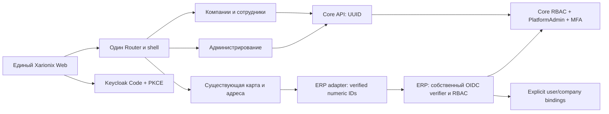

# Единый Xarionix Web — Sprint 6B.0

## Аудит контрактов и baseline

Web `3f1169c5832cfdbe9b15d2555f09531fe0e3d9d1`, Core
`6b2bbf813d717f994b3695f2ae26baeecdfa6a45`; оба дерева изначально чистые.
ERP найден рядом, HEAD `08e5f63b82e38b41aa97e17355079d6ef2312977`, также чистый.

| Контракт | ERP | Core |
| --- | --- | --- |
| Существующий пользователь/компания | number | UUID |
| Авторизация | numeric membership + ERP permission/scope | Core effective permissions |
| Старый вход | Password + HS JWT + Redis session | Keycloak Code + PKCE |
| Совместимый SSO путь | Opt-in RS256 OIDC + собственная ERP audience + explicit bindings | Та же Keycloak session, собственная Core audience |
| API | `/api/v1` | `/core-api/api/v1` через same-origin proxy |
| Администрирование | Только существующие ERP grants | PlatformAdmin DB grant + свежий MFA |

Совпадение названия/email не доказывает identity/company binding. UUID не приводится
к number. Старый HS verifier не используется для Keycloak JWT.

## Принятые решения

1. Существующие Console features перенесены в `src/app/platform`, сохранены
   типизированный Core client, страницы и тесты. Один production bootstrap,
   Router, shell, профиль, уведомления и Core company context.
2. `/admin` lazy loaded; guards требуют серверную capability. MFA challenge
   не загружает административные данные. Старые `/platform` URL redirect.
3. Карта и адреса lazy loaded в **ту же оболочку** через `platform/erp` adapter.
   Контекст numeric ERP IDs поступает только из verified backend response.
   Смена компании/выход отменяет старые запросы и очищает ERP контекст/права.
4. ERP получает additive, отключённый по умолчанию OIDC integration layer.
   Проверяет подпись/issuer/свою audience/client, fresh Core human/membership,
   operator bindings и старые ERP права. Данные и legacy сессии не меняются.
5. Один HTTPS Nginx vhost обслуживает один build и разделённые upstream contracts.
   Legacy login/setup UI и endpoints не публикуются общей оболочкой.
   Runtime и JS из `.xpkg` наружу не публикуются.
6. Regression/typecheck/build, реальный browser PKCE/MFA и серверная ERP проверка
   дополняют прежний MapLibre WebGL runner. SDK/persistence используют отдельную
   runtime/deployment trust boundary.

## Границы миграции

Совместная Keycloak session карты/адресов подтверждается реальным Core + ERP +
Keycloak integration test, а не общим доменом. Остальные старые ERP страницы
сохранены в `xarionix-erp-legacy`; они не объявляются полностью мигрированными
в Core company/employee/role model. Core company pages используют свои UUID DTO.

Compatibility Console target собирает тот же entry point; порт 4300 не нужен
пользователю. Legacy ERP target предназначен для regression/migration, не второй
production SPA. Операторские bindings существующих данных требуют проверки
реальных записей: рабочие данные в этой задаче не связывались автоматически.
