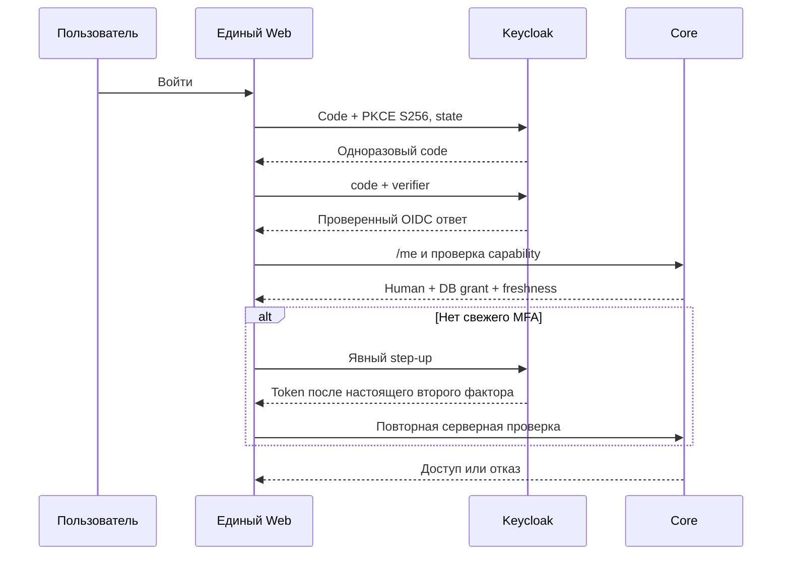
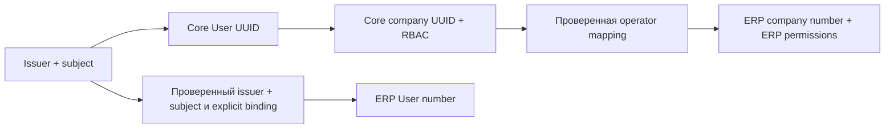

# Единый вход Xarionix

Публичный `xarionix-web` и временный compatibility target Console используют
одни `Auth`, `Session`, Router и shell из `src/app/platform`. Единственный вход —
`/login` → Keycloak Authorization Code + PKCE S256 → `/auth/callback`.
Frontend — public client без client secret. Access token и OIDC User находятся
в памяти; sessionStorage содержит только краткоживущее состояние транзакции.
После reload начинается новый OIDC redirect, использующий сессию IdP. Это не
сохранение пользовательского JWT в browser storage.

CoreApi отправляет JWT только помеченным запросам к настроенному
same-origin `/core-api/api/v1`. Отдельный opt-in ERP interceptor отправляет его
только в разрешённые same-origin map/address endpoints, где ERP независимо
проверяет свою audience; Core-only JWT отвергается. Cookies ERP не отправляются в Core; reverse proxy
также удаляет Cookie/Set-Cookie. Company context — Core UUID, effective permissions
перепроверяются сервером. Переключение компании/выход отменяет старые запросы.

## Администратор

Для bootstrap применяется существующая [процедура Core](../../xarionix-core/docs/platform-administration.md):
оператор проверяет реальную `(issuer, subject)` identity, явно классифицирует human
и выполняет server-side bootstrap с audit. Пароль bootstrap Keycloak не является
учётной записью Xarionix. Frontend не назначает grants и не доверяет JWT role.

`Session.probeAdmin()` вызывает защищённый Core endpoint. Только успешный ответ
разрешает `/admin`. Ответ `configured_recent_mfa_required` показывает возможность
повторного входа; страницы с данными остаются закрытыми. Step-up передаёт согласованный
ACR и `max_age=0`; окончательное решение всегда принимает Core по подписанным
claims и DB grant. Ошибка/недоступность сервера не даёт административный доступ.
После 403 прежняя административная capability сбрасывается.

Единая OIDC session карты/адресов проверена настоящим браузерным E2E с обоими
backend. ERP bindings создаются только доверенным CLI, не первым login. Core
Platform Admin не становится ERP administrator автоматически. Fresh Core checks
выполняются на каждом ERP OIDC запросе; при отказе/недоступности нет password
fallback. Прежние ERP права и private owner IDs сохраняются.

Старый password login сохранён только для compatibility target и прежних API
клиентов. Общий Web не публикует эту форму и не вызывает login/refresh. Остальные
исторические ERP страницы не объявляются полностью мигрированными. См.
[операторскую процедуру ERP](../../xarionix-erp/docs/platform-oidc.md).
